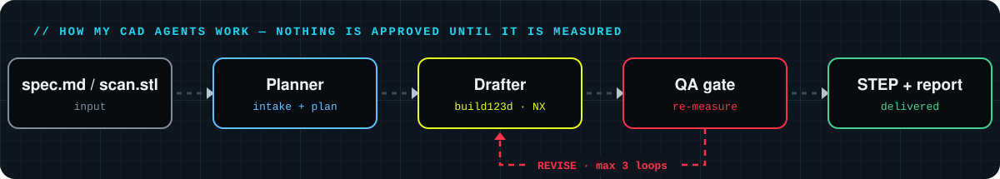
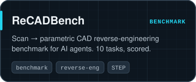
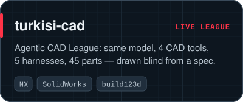
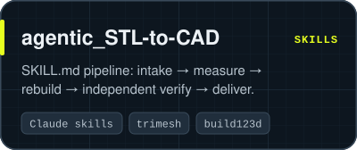
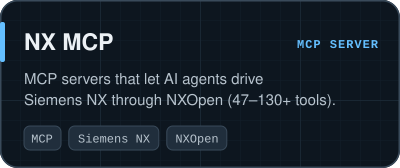
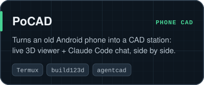
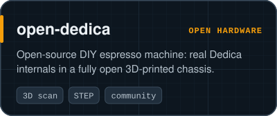
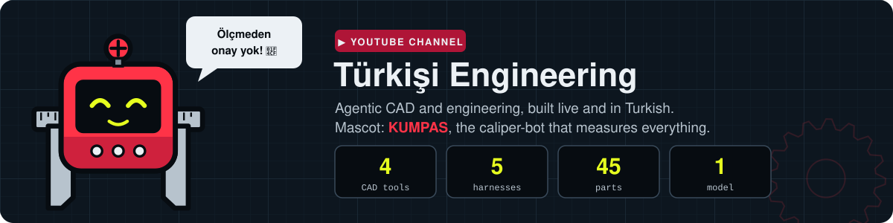
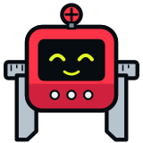

  

  
  
  
  

### 👋 Hi, I'm İkbal

Doctoral researcher at **KAUST**. I build **agentic engineering pipelines**: AI agents that read a spec or a 3D scan,
model the part in real CAD (build123d, Siemens NX, SolidWorks), **measure their own output**, and only hand it over when
the numbers pass.

- 🔭 **Now:** blind CAD benchmarks for agents (Agentic CAD League, ReCADBench) and scan → design-intent CAD
- 🧩 **Also:** MCP servers that let agents drive Siemens NX, and Claude skills for scan → CAD
- 🤝 **Open to:** collaborations on agentic AI for engineering, CAD benchmarks, MCP tooling

  

## 🛠️ What I'm building

<table>
  <tr>
    <td width="50%"></td>
    <td width="50%"></td>
  </tr>
  <tr>
    <td width="50%"></td>
    <td width="50%"></td>
  </tr>
  <tr>
    <td width="50%"></td>
    <td width="50%"></td>
  </tr>
</table>

More: <a href="https://github.com/mikbalarikan/nx-auto-mcp">nx-auto-mcp</a> · <a href="https://github.com/mikbalarikan/oguz-cad">oguz-cad</a> (printed parts from an autonomous CAD agent) · <a href="https://github.com/mikbalarikan/khan-explainer">khan-explainer</a> · <a href="https://github.com/mikbalarikan/video-use">video-use</a> · <a href="https://github.com/mikbalarikan/ML_for_ME">ML for Mechanical Engineers</a> · <a href="https://github.com/mikbalarikan/ADSA_PD">ADSA</a> (surface tension from droplet images)

## 📺 Türkişi Engineering

  

## 🧰 Toolbox

  
  
  
  
   
  
  
  

   
  <i>“Nothing is approved until it is measured.” — KUMPAS</i>

